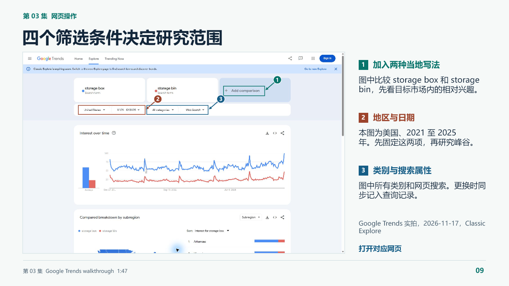

# Google Trends Research Kit

把 Google Trends 官方教程里的方法，转成可以检索、复核和调用的中文研究工具。适用于欧美市场的日用品选品、图书选题、内容排期与市场分析。

[打开方法库演示](https://baoshuai921.github.io/google-trends-research-kit/) · [阅读五页课件样章](https://baoshuai921.github.io/google-trends-research-kit/sample/) · [跑通一个例子](docs/example.md) · [反馈问题](https://github.com/BaoShuai921/google-trends-research-kit/issues/new/choose)

**English:** A Chinese-first Google Trends research kit with 34 searchable methods, source timestamps, annotated lessons and a reusable Agent Skill. It helps plan and interpret research; arbitrary-keyword historical data requires web access or an approved API.

## 里面有什么

| 内容 | 用途 |
| --- | --- |
| 34 条方法、8 个主题 | 每条包含操作步骤、解释边界、官方帮助与视频时间戳 |
| 离线可用的方法库 | 浏览器打开 `docs/index.html`，输入“季节性”“YouTube”等词检索 |
| `google-trends-research` 技能 | 根据业务问题选择方法、准备查询、记录证据 |
| 3 个 Node.js 脚本 | 检索方法、生成查询计划、读取 Trending Now 公开 RSS |
| 5 页中文样章 | 真实网页截图上的编号、框和箭头，配合读图说明与练习 |

方法以 Google Search Central 的 [Google Trends Tutorials](https://www.youtube.com/playlist?list=PLKoqnv2vTMUO8MUpCbVIiBaDZYrpNF8f-) 十集系列及官方帮助为主要来源。正文保留英文术语。功能与资料核对日期：**2026-11-18**。

## 一分钟试用

不需要账号即可使用本地方法库。[下载仓库 ZIP](https://github.com/BaoShuai921/google-trends-research-kit/archive/refs/heads/main.zip)、解压，用浏览器打开 `docs/index.html`。网页不加载外部字体、分析脚本或前端依赖。

运行脚本需要 **Node.js 22 或更高版本**，无需 `npm install`。在仓库根目录执行：

```sh
node skills/google-trends-research/scripts/search.mjs --query "美国收纳盒 季节性" --limit 3
```

生成两种商品叫法的查询计划：

```sh
node skills/google-trends-research/scripts/query-plan.mjs --terms "storage box|storage bin" --geo US --start 2021-01-01 --end 2025-12-31 --property web
```

输出当前入口、筛选参数和经典版查询链接。打开网页后仍需核对参数、输入类型和当前界面；经典版正在退出，链接可用性以实际网页为准。

```sh
node skills/google-trends-research/scripts/rss.mjs --geo US
```

这会联网读取官方 Trending Now RSS，保留其实际返回的时间和搜索量级。它提供热搜线索。任意商品词的长期走势需另查 Explore。

## 安装为项目技能

将 `skills/google-trends-research` **整个目录**复制到目标项目的 `.agents/skills/`，得到：

```text
你的项目/
  .agents/skills/google-trends-research/
    SKILL.md
    agents/
    references/
    scripts/
```

例如，在 Codex CLI 或 IDE 中提问：

```text
$google-trends-research
我准备向美国销售收纳用品。请比较 storage box 与 storage bin 的长期季节性，
先确认口径、选择方法并生成查询计划；取得真实数据后再给试售建议。
```

Codex 的本地技能发现位置和调用方式见 [官方技能说明](https://learn.chatgpt.com/docs/build-skills)。其他支持 Agent Skills 的工具可按其说明导入技能目录；本仓库未逐一验证兼容性。模型及浏览器能力由使用者的工具提供。

## 数据与授权边界

| 渠道 | 本项目能做什么 | 需要什么 |
| --- | --- | --- |
| 本地方法库、查询计划 | 检索、解释、生成参数与链接 | 无账号、无 API 密钥 |
| Trending Now RSS | 读取公开榜单返回的字段 | 可访问 Google 的网络 |
| Explore 网页、CSV | 指导操作、按可用工具取得和分析证据 | 当前网页能力；新版通常需 Google 账号登录 |
| 官方 API alpha | 提供接入前的能力与授权说明 | 申请获准、官方认证与配额；本项目未实测获准 API |
| BigQuery、Search Console、Google Ads | 按适用范围安排辅助验证 | 对应项目、站点或账号的授权，可能有服务费用 |

详见 [账号、API 与费用说明](skills/google-trends-research/references/access.md)。本项目没有封装任意关键词历史数据的自动抓取接口。搜索兴趣指数、热搜搜索量级和 API 一致缩放值需分别解释；搜索兴趣不能直接当成销量、利润或购买意愿。

## 一个可复现的研究起点

[美国收纳盒研究例子](docs/example.md) 从中文需求检索方法，生成固定日期的比较计划，再用证据模板记录真实导出。例子包含可运行的本地步骤与网页复核步骤，市场判断需填写本次取得的数据。



## 来源、许可与再利用

- JavaScript、HTML/CSS 结构及配置代码采用 [MIT](LICENSE)。
- 原创中文说明、方法条目的原创编排、练习和标注说明采用 [CC BY 4.0](LICENSE-CONTENT.txt)，署名 **BaoShuai921 / Google Trends Research Kit**，附项目链接并注明修改。
- Google 产品界面、数据、商标及其他第三方材料保留原权利与适用使用条件，不在本项目的 MIT / CC BY 授权范围内。分界和素材出处见 [NOTICE](NOTICE.md) 与 [素材清单](docs/credits.md)。

允许在上述各自许可范围内修改、商用和再分发。Google Trends 是 Google LLC 的商标。本项目为独立研究与教学材料，与 Google 无关联或背书关系。内容使用 AI 辅助整理，复用时请保留出处并复核当前界面。

## 反馈与贡献

欢迎提交“哪个任务、用了哪条方法、卡在哪里、期望得到什么”的反馈。界面变化、解释错误、安装问题和实际使用案例都很有帮助。公开反馈请移除账号、密钥和业务机密。

修改方法时请附官方来源、时间定位和解释边界，详见 [贡献说明](CONTRIBUTING.md)。维护者可按 [流量观察说明](.github/MAINTAINER.md) 记录访问、克隆与具体使用反馈。

本地检查：`node --test`；重建网页：`node scripts/build-site.mjs`。
