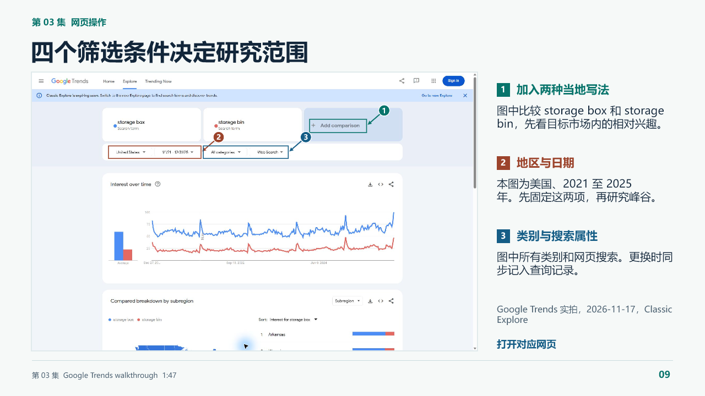
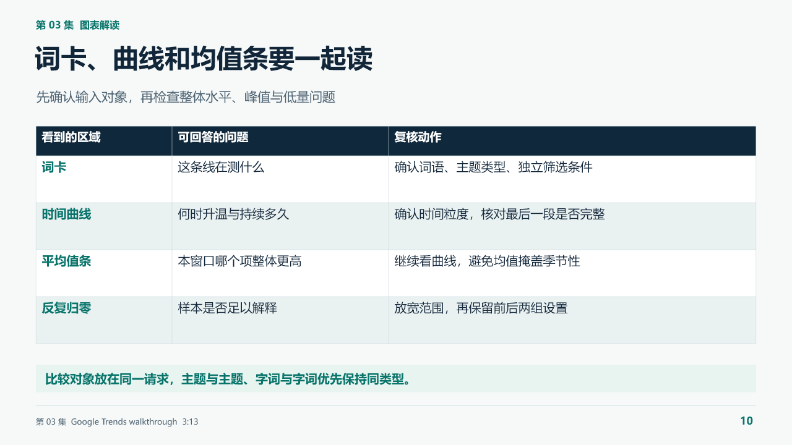
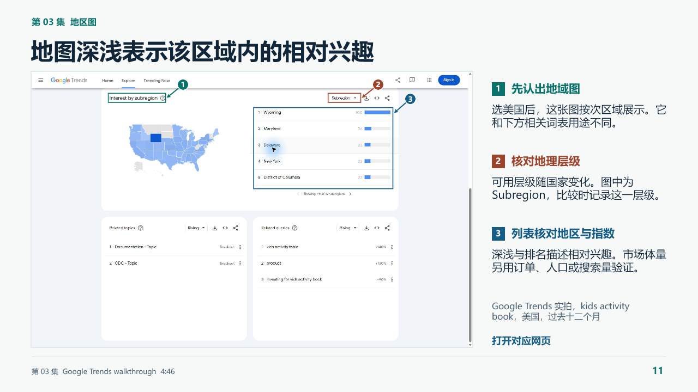
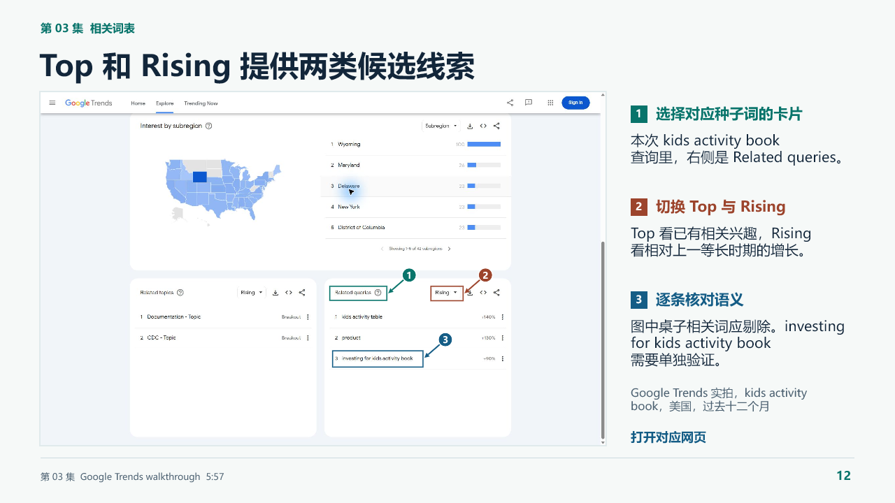
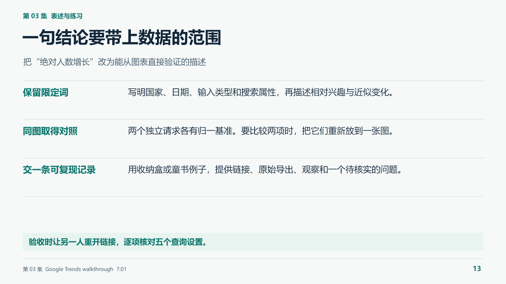

# 五页样章：网页操作与读图

[连续阅读网页版](index.html) · [返回项目](../../README.md)

这一章练习从查询设置走到有范围的观察：固定筛选条件，读曲线与地图，筛掉无关的关联词，最后交一条可复现记录。

截图为 **2026-11-17 的 Classic Explore 历史教学记录**。当前新版入口、登录与控件以实际页面为准，见 [访问说明](../../skills/google-trends-research/references/access.md)。下列静态课堂页可点击查看原尺寸。

## 1. 固定四个筛选条件

先确认比较对象。图中 ① 是两种当地写法，② 固定美国与 2021–2025，③ 固定类别和网页搜索。

## 2. 词卡、曲线、均值条一起读

均值可能掩盖短期高峰，频繁归零也可能是低量。比较对象应放在同一请求中，输入类型保持一致。

## 3. 地图表示地区内的相对兴趣

图中 ① 定位地域卡片，② 核对 Subregion 层级，③ 在列表核对地区和指数。不能仅凭颜色推算购买人数。

## 4. Top 与 Rising 用于生成候选

图中 ① 定位相关查询，② 切换 Top/Rising，③ 检查具体词的语义。桌子类结果可能偏离童书任务，应剔除。当前机会要重新查询。

## 5. 提交一条可复现记录

任选收纳盒或儿童活动书：写清国家、日期、输入类型、类别和搜索属性，保留链接、原始导出、观察与一个待核实的问题。用 [证据模板](../../skills/google-trends-research/references/evidence-template.json) 填写实际记录。

方法来自 [官方 walkthrough 视频](https://www.youtube.com/watch?v=GXpGoUw4YUw) 与帮助页面，素材和许可分界见 [素材清单](../credits.md)。Google Trends 是 Google LLC 的商标；本章为独立教学材料，与 Google 无关联或背书关系。
